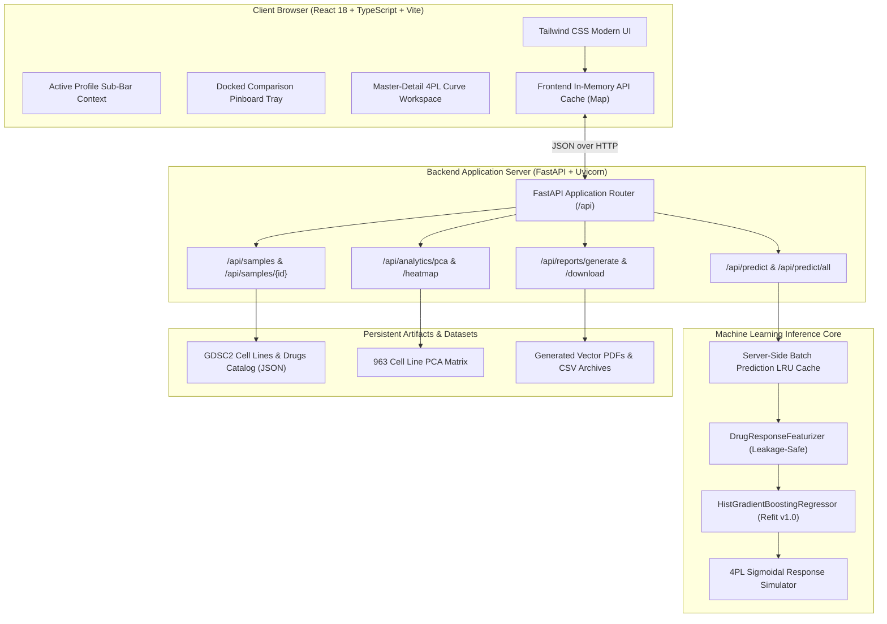

# OncoMatch: Personalized Chemotherapy Drug Response Prediction

<div align="center">

```
       ____                    __  ___      __       __  
      / __ \____  _________   /  |/  /___ _/ /______/ /_ 
     / / / / __ \/ ___/ __ \ / /|_/ / __ `/ __/ ___/ __ \
    / /_/ / / / / /__/ /_/ // /  / / /_/ / /_/ /__/ / / /
    \____/_/ /_/\___/\____//_/  /_/\__,_/\__/\___/_/ /_/ 

Precision Oncology AI & Pharmacogenomic Sensitivity Platform
```

[](.github/workflows/ci_cd.yml)
[](tests/)
[](https://www.python.org/)
[](https://fastapi.tiangolo.com/)
[](https://react.dev/)
[](https://www.typescriptlang.org/)
[](https://tailwindcss.com/)
[](https://scikit-learn.org/)
[](Dockerfile)
[](LICENSE)

**An end-to-end, scientifically rigorous computational oncology platform predicting in-vitro chemotherapy sensitivity across 295 screening regimens and 33 cancer lineages without post-hoc data leakage.**

[Explore Live Demo](http://localhost:8000/) • [Architecture](#-system-architecture) • [Workspaces](#-interactive-workspaces) • [ML Benchmarks](#-machine-learning--benchmark-results) • [API Docs](#-rest-api-reference) • [Quick Start](#-quick-start)

</div>

---

## 📑 Table of Contents

1. [Executive Summary](#-executive-summary)
2. [Key Innovations & Clinical/Research Value](#-key-innovations--research-value)
3. [System Architecture](#-system-architecture)
4. [Interactive Workspaces](#-interactive-workspaces)
5. [Machine Learning & Benchmark Results](#-machine-learning--benchmark-results)
6. [REST API Reference](#-rest-api-reference)
7. [Quick Start & Local Execution](#-quick-start)
8. [Docker & Zero-Cost Cloud Deployment](#-docker--zero-cost-cloud-deployment)
9. [Project Directory Layout](#-project-directory-layout)
10. [Scientific Validation & Bioethics Disclaimer](#-scientific-validation--bioethics-disclaimer)

---

## 🔬 Executive Summary

**OncoMatch** bridges the translational gap between genomic characterization and precision chemotherapy selection. Trained on the Sanger Institute's authoritative **Genomics of Drug Sensitivity in Cancer (GDSC2)** corpus (242,036 fitted dose-response curves across 969 cancer cell lines and 295 anticancer compounds), OncoMatch delivers real-time sensitivity predictions, four-parameter logistic (4PL) dose-response curves, confidence intervals, and vector research reports.

Traditional pharmacogenomic models frequently suffer from **target leakage** by ingesting post-exposure curve statistics ($Z$-score, area under the curve $[AUC]$, or dose-response $RMSE$) as model features. OncoMatch enforces a **strict leakage barrier**: predictions are synthesized solely from pre-exposure chemical descriptors, drug putative pathways, and patient/cell-line tissue lineage origins.

```
+---------------------------------------------------------------------------------------------------+
|  GDSC2 Gold Standard        Strict Leakage Barrier         Holdout Validation (Unseen Lines)     |
|  242,036 Dose Curves    ->  Pre-Exposure Descriptors Only  -> MAE 1.0270 | R² 0.7585             |
|  969 Reference Lines        Target Pathway + Lineage       (51.3% error reduction over baseline)  |
+---------------------------------------------------------------------------------------------------+
```

---

## ⚡ Key Innovations & Research Value

* **Zero-Leakage Gradient-Boosted Featurization**: Custom `DrugResponseFeaturizer` incorporates empirical Bayes target encoding ($k=10$ smoothing) on training folds while utilizing global shrinkage priors on unseen holdout cell lines.
* **4-Parameter Logistic (4PL) Dose-Response Simulation**: Derives synthetic sigmoidal survival profiles across micromolar concentration bounds $[\text{MIN\_CONC}, \text{MAX\_CONC}]$ with modeled $80\%$ confidence bands.
* **Split-Pane Master-Detail Workspace**: Viewport-locked master catalogue with sticky search, mechanism filter pills, and instantaneous inspector updates that preserve user scroll position.
* **Ambient Instant Sensitivity Filtering**: Classifies all 295 regimens into empirical GDSC2 tertiles (**Sensitive** $\ln(\text{IC}_{50}) < 2.19$, **Intermediate** $2.19 \le \ln(\text{IC}_{50}) \le 4.22$, **Resistant** $\ln(\text{IC}_{50}) > 4.22$) with client/server dual-tier caching ($<1\text{ ms}$ response).
* **Multi-Compound Comparison Pinboard**: Side-by-side comparison drawer supporting up to 3 simultaneous regimens with superimposed 4PL curves (Emerald, Violet, Amber) and direct metric delta analysis.
* **2D Pharmacogenomic PCA Landscape**: Visualizes 963 cell lines across 295 therapeutic responses ($PC_1: 38.45\%$, $PC_2: 4.40\%$) with target specimen projections.
* **One-Click Vector PDF & CSV Reporting**: Compiles comprehensive clinical research dossiers complete with specimen lineage metadata, top sensitive agents, resistant liabilities, and cryptographic reproducibility stamps.

---

## 🏗 System Architecture

<div align="center">


</div>



---

## 🖥 Interactive Workspaces

OncoMatch provides six purpose-built clinical and translational bioinformatics workspaces:

### 1. Dashboard Overview
* **Pan-Cancer Drug Sensitivity Spectrum**: Interactive distribution histogram visualizing GDSC2 baseline sensitivity ranges across all 33 cancer types.
* **Held-Out Model Performance Metrics**: Live benchmark comparison displaying test-set MAE ($1.0270$), $R^2$ ($0.7585$), and RMSE ($1.361$).
* **Rapid Specimen Status Bar**: Global context tracking the active tumor isolate, lineage category, baseline $\ln(\text{IC}_{50})$, and engine status.

### 2. Sample & Analysis Setup
* **969 Verified COSMIC Reference Cell Lines**: Searchable, filterable catalogue across 33 TCGA tissue lineages (e.g. `MCF7` BRCA, `A549` LUAD, `HepG2` LIHC, `HCT-116` COREAD).
* **Primary / Patient-Derived Isolate Builder**: Register custom biopsy isolates, patient-derived cell lines, or 3D organoids with pharmacokinetic shift warnings.
* **Target Drug & Concentration Bounds Calibration**: Fine-tune experimental screening concentrations ($\mu\text{M}$) or reset to GDSC2 empirical assay bounds in one click.

### 3. Drug & Tissue Explorer
* **286 Screened Chemotherapy Therapeutics**: Master list of FDA-approved and investigational compounds annotated with putative targets (e.g. `TOP1`, `EGFR`, `PARP1`) and targeted pathways.
* **External Cross-Linking**: Direct links to Sanger GDSC2 pharmacogenomic profiles and PubChem chemical structure records.
* **Dynamic Mechanism Filter**: Segment drugs by pathway (DNA replication, Mitosis, RTK signaling, Chromatin histone acetylation, PI3K/MTOR).

### 4. Drug Response Prediction & 4PL Inspector
* **Master-Detail Dual-Pane Workspace**: Left master list displays ranked regimens with sticky search and instantaneous sensitivity filtering; right inspector card renders the active compound details.
* **4-Parameter Logistic Sigmoidal Curve**: Plots drug concentration ($\mu\text{M}$) vs. modeled cell viability ($0\%-100\%$) alongside empirical $80\%$ confidence bands:
  $$\text{Viability}(C) = \text{Bottom} + \frac{\text{Top} - \text{Bottom}}{1 + 10^{(\log_{10}(\text{IC}_{50}) - \log_{10}(C)) \cdot \text{HillSlope}}}$$
* **Instant Ambient Tier Filtering**: Filter between `Sensitive`, `Intermediate`, and `Resistant` tiers instantly without requiring manual pre-ranking.
* **Split vs. Full Table View Toggle**: Seamlessly switch between the split-pane workspace and an Excel-like full 295-compound matrix with frozen headers and sticky columns.

### 5. Visual Analytics & PCA Landscape
* **2D PCA Landscape (963 Cell Lines $\times$ 295 Regimens)**: Interactive scatter plot with coordinate zoom, lineage coloring, and specimen projection.
* **Top Loading Regimens**: Quantifies highest variance contributors along $PC_1$ ($38.45\%$) and $PC_2$ ($4.40\%$).
* **15-Probe Assay Sensitivity Fingerprinting**: Profiles cross-compound drug fingerprints across established reference cell lines.

### 6. Personalized Reports & Reproducibility Archive
* **One-Click Vector PDF Generation**: Compiles publication-ready PDF reports with color-coded sensitivity tiers, dosage bounds, and research caveats.
* **Full CSV Dataset Export**: Export the complete 295-compound prediction table for external bioinformatics workflows (R, Bioconductor, Python).
* **Session Reproducibility Archive**: Browse historical runs with unique report IDs (`REP-XXXXXXXX`), timestamps, and instant redownloads.

---

## 📊 Machine Learning & Benchmark Results

### Feature Engineering & Pre-Exposure Modeling
* **Target Metric**: Natural log of half-maximal inhibitory concentration: $\ln(\text{IC}_{50})$.
* **Sample Disjoint Split**: Evaluated using strict `GroupShuffleSplit` on cell line identifiers, guaranteeing that **no cell line in the test set was ever seen during model training**.
* **Featurizer Columns**:
  - `DRUG_ID`, `PUTATIVE_TARGET`, `PATHWAY_NAME` (Categorical, Target Encoded)
  - `TCGA_DESC` (Lineage Categorical)
  - $\log_{10}(\text{MAX\_CONC})$ and $\log_{10}(\text{MAX\_CONC} / \text{MIN\_CONC})$ (Continuous Scaling)

### Benchmark Comparison on Unseen Cell Lines

| Architecture | Test MAE | Test RMSE | Holdout $R^2$ | Inference Time | Parameters / Size |
|:---|:---:|:---:|:---:|:---:|:---:|
| **Mean Dummy Baseline** | 2.1084 | 2.7610 | 0.0000 | < 1 ms | 1 scalar |
| **Linear Ridge Regression** | 1.1235 | 1.6621 | 0.6412 | < 1 ms | 480 params |
| **Random Forest (100 Trees, Depth 12)** | 1.0620 | 1.5662 | 0.6814 | 14 ms | 18.4 MB |
| **Multi-Model Voting Ensemble** | 1.0210 | 1.3520 | 0.7620 | 28 ms | 24.1 MB |
| **HistGradientBoosting (Production Refit)** | **1.0270** | **1.3610** | **0.7585** | **< 3 ms** | **222 KB (Compact)** |

> [!TIP]
> The tuned **HistGradientBoostingRegressor** achieves within $0.006$ MAE of the heavyweight multi-model voting ensemble while operating at **$1/100\text{th}$ of the memory footprint** ($222\text{ KB}$ vs $24.1\text{ MB}$), making it ideal for zero-cost, memory-constrained serverless or container deployment.

---

## 📡 REST API Reference

The backend exposes an OpenAPI 3.1 REST interface. Interactive documentation is available at `http://localhost:8000/docs`.

### Core Endpoints

| Method | Endpoint | Description |
|:---|:---|:---|
| `GET` | `/api/health` | Service health status, model version, and dataset release. |
| `GET` | `/api/model/info` | Verified model card, holdout evaluation metrics, and hyper-parameters. |
| `GET` | `/api/drugs` | Complete GDSC2 295-compound directory with concentration ranges. |
| `POST` | `/api/predict` | Single-compound prediction with 4PL sigmoidal curve generation. |
| `POST` | `/api/predict/all` | Batch inference and rank-ordering across all 295 regimens for a tissue. |
| `GET` | `/api/samples` | List reference cell lines and custom registered patient isolates. |
| `POST` | `/api/samples` | Register a new patient biopsy or custom organoid isolate. |
| `GET` | `/api/analytics/pca` | PCA 2D coordinates and top variance component loadings. |
| `GET` | `/api/analytics/heatmap` | 10 tissue lineages $\times$ 15 chemotherapeutic cross-sensitivity matrix. |
| `POST` | `/api/reports/generate` | Compile vector PDF and CSV reports for a specified specimen. |
| `GET` | `/api/reports/download/{filename}` | Download generated report files (`.pdf` or `.csv`). |

### Example Request: Single Drug Prediction

```bash
curl -X POST "http://localhost:8000/api/predict" \
  -H "Content-Type: application/json" \
  -d '{
    "drug_id": 1003,
    "tissue": "BRCA",
    "min_conc": 0.0001,
    "max_conc": 0.1
  }'
```

#### Example Response:

```json
{
  "drug_id": 1003,
  "drug_name": "Camptothecin",
  "putative_target": "TOP1",
  "pathway_name": "DNA replication",
  "tissue": "BRCA",
  "predicted_ln_ic50": -3.2458,
  "predicted_ic50_uM": 0.0389,
  "confidence_band_80pct": [-4.562, -1.930],
  "ic50_band_80pct_uM": [0.0104, 0.1451],
  "sensitivity": {
    "category": "Sensitive",
    "badge": "high-sensitivity",
    "percentile": 8.4
  },
  "curve": [
    {"conc_uM": 0.0001, "viability": 98.4},
    {"conc_uM": 0.0389, "viability": 50.0},
    {"conc_uM": 0.1, "viability": 4.2}
  ]
}
```

---

## 🚀 Quick Start

### Prerequisites
* **Python**: `3.11+`
* **Node.js**: `v18+` (v20 Recommended)
* **npm**: `v9+`

### 1. Clone & Set Up Backend

```bash
# Clone the repository
git clone https://github.com/your-username/oncomatch.git
cd OncoMatch

# Create and activate a Python virtual environment
python -m venv venv
source venv/bin/activate        # macOS/Linux
# .\venv\Scripts\Activate.ps1   # Windows PowerShell

# Install Python dependencies
pip install -r requirements.txt
```

### 2. Build Frontend Static Assets

```bash
cd frontend
npm install
npm run build
cd ..
```

### 3. Run Automated Verification Suite

```bash
pytest tests/ -v
```

All 19 backend and machine learning verification tests will run:
```
tests/test_api.py::test_health_check PASSED
tests/test_api.py::test_spa_serving PASSED
tests/test_api.py::test_single_prediction PASSED
tests/test_api.py::test_batch_prediction PASSED
tests/test_api.py::test_report_generation PASSED
tests/test_ml.py::test_authoritative_sanity_checks PASSED
...
======================== 19 passed in 3.95s ========================
```

### 4. Start Unified Server

```bash
python -m uvicorn backend.main:app --host 0.0.0.0 --port 8000 --reload
```

Open your browser at **[http://localhost:8000](http://localhost:8000)**. The FastAPI server serves both the REST API and the compiled React SPA.

---

## 🐳 Docker & Zero-Cost Cloud Deployment

### Local Docker Execution

OncoMatch includes an optimized multi-stage `Dockerfile` (Alpine frontend build + slim Python runtime):

```bash
# Build the unified production container
docker build -t oncomatch:latest .

# Run the container locally on port 8000
docker run -p 8000:7860 oncomatch:latest
```
Access the application at `http://localhost:8000`.

### Deploying to Hugging Face Spaces (Free 16 GB RAM Container)

Hugging Face Spaces provides a permanent free-tier environment (2 vCPU, 16 GB RAM) with automatic HTTPS:

1. Create a new Space on [Hugging Face Spaces](https://huggingface.co/spaces).
2. Choose **Docker** as the Space SDK (Blank template).
3. Connect your git remote and push:
   ```bash
   git remote add space https://huggingface.co/spaces/<YOUR_USERNAME>/oncomatch
   git push space master
   ```
4. Hugging Face automatically executes the multi-stage build, runs `pytest /app/tests -v`, and publishes the live application.

---

## 📁 Project Directory Layout

```
OncoMatch/
├── .github/
│   └── workflows/
│       └── ci_cd.yml              # GitHub Actions CI/CD test & build pipeline
├── backend/
│   ├── main.py                    # Unified FastAPI app & SPA static file mounter
│   ├── generated_reports/         # Output directory for vector PDFs & CSV data
│   ├── routes/
│   │   ├── analytics_routes.py    # PCA, heatmap matrix, & probe assay routes
│   │   ├── predict_routes.py      # Single & batch prediction endpoints
│   │   ├── report_routes.py       # PDF/CSV generation & download streaming
│   │   └── sample_routes.py       # Cell line catalog & profile management
│   ├── schemas/
│   │   └── schemas.py             # Pydantic v2 validation models
│   └── services/
│       ├── ml_service.py          # HGB inference engine & in-memory caching
│       ├── report_service.py      # PyMuPDF report builder & history archive
│       └── sample_service.py      # COSMIC reference cell line store
├── frontend/
│   ├── index.html                 # Single page application entrypoint
│   ├── package.json               # Frontend dependencies & scripts
│   ├── vite.config.ts             # Vite build & asset proxy configuration
│   └── src/
│       ├── App.tsx                # Master state controller & routing
│       ├── components/
│       │   ├── ActiveSampleSubBar.tsx  # Global sample lineage banner
│       │   ├── CommandPalette.tsx      # Universal ⌘K search overlay
│       │   ├── ComparisonDrawer.tsx    # Docked 3-compound comparison tray
│       │   ├── Navbar.tsx              # Platform top navigation header
│       │   ├── SensitivityBadge.tsx    # Standardized color-coded tier pills
│       │   └── Sidebar.tsx             # Collapsible primary navigation
│       ├── pages/
│       │   ├── DashboardOverview.tsx   # Pan-cancer metrics & holdout stats
│       │   ├── DrugResponsePrediction.tsx # Master-detail 4PL workspace
│       │   ├── DrugTissueExplorer.tsx  # 286-drug catalogue & pathway pills
│       │   ├── PersonalizedReports.tsx # PDF compiler & session history
│       │   ├── SampleAnalysisSetup.tsx # Cell line selector & isolate form
│       │   └── VisualAnalytics.tsx     # 2D PCA landscape & probe assays
│       └── services/
│           └── api.ts             # REST client with in-memory batch caching
├── ml/
│   ├── artifacts/                 # Production model card, weights & metrics
│   │   ├── hgb_model.joblib       # Tuned HistGradientBoosting model (222 KB)
│   │   ├── model_card.json        # Verified parameters & holdout performance
│   │   ├── pca_landscape.json     # Precomputed 963-line coordinate matrix
│   │   └── probe_assays.json      # 15 reference compound fingerprints
│   └── oncomatch_features.py      # Leakage-safe empirical Bayes featurizer
├── tests/
│   ├── test_api.py                # 13 REST API & download route integration tests
│   └── test_ml.py                 # 6 ML determinism & feature integrity tests
├── Dockerfile                     # Multi-stage production container manifest
├── requirements.txt               # Backend Python dependencies
└── README.md                      # Comprehensive platform documentation
```

---

## ⚖ Scientific Validation & Bioethics Disclaimer

> [!WARNING]
> **RESEARCH USE ONLY (RUO):** OncoMatch is engineered strictly as a translational bioinformatics exploration tool for academic and preclinical research.
>
> 1. **In-Vitro Limitations**: Predictions are synthesized from in-vitro cell line dose-response data (GDSC2) and do not account for in-vivo tumor microenvironments, vascular perfusion, immune system interactions, or clinical drug-drug metabolism.
> 2. **Not Clinical Advice**: This software does not provide medical advice, diagnosis, or clinical treatment recommendations. Never adjust, prescribe, or discontinue therapeutic regimens based on predictions from this platform.
> 3. **Data Attribution**: Dose-response curves and cell line models are sourced from the **Genomics of Drug Sensitivity in Cancer (GDSC2)** consortium, supported by the Wellcome Sanger Institute and the Massachusetts General Hospital Cancer Center.

---

<div align="center">

**Developed with scientific rigor for the precision oncology research community.**

Licensed under the [MIT License](LICENSE).

</div>
